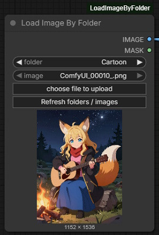

# LoadImageByFolder-ComfyUI

[中文](Readme_CN.md)

A ComfyUI custom node that organizes images in the input directory by folder, so you can select images without scrolling through one long list.

## Features

- Browse the ComfyUI input directory and its subfolders with separate folder and image selectors. `.` represents the input root.
- Preview the selected image and output `IMAGE` and `MASK` using ComfyUI's native LoadImage implementation.
- Upload an image with **choose file to upload**, or drag a local image onto the node. The image is saved in the selected input folder.
- Drag an image from ComfyUI's **Assets** sidebar onto the node to copy it into the selected input folder.
- Refresh folders and images with **Refresh folders / images**. Saved workflow selections are restored when available.

Supported filename extensions: PNG, JPG, JPEG, WEBP, BMP, GIF, TIF, and TIFF. Actual image and animation handling depends on ComfyUI's native LoadImage support.

## Installation

1. Copy the repository clone URL from **Code** on its GitHub page.
2. Open a terminal in `ComfyUI/custom_nodes` and run `git clone <repository-url>`, replacing `<repository-url>` with the URL you copied. Alternatively, download the repository as a ZIP and extract its project folder into `custom_nodes`.
3. Restart ComfyUI and refresh the browser page.
4. Add **Load Image By Folder** from the `image` category.

This node uses the dependencies provided by ComfyUI and does not require a separate installation step for additional packages.

## Usage

1. Choose an input folder using **folder**. For example, `.` is the input root and `car` is `input/car`.
2. Choose an image using **image**, or add one using the upload button or drag and drop. A newly added image is selected automatically if the node is still viewing the destination folder.
3. Connect the `IMAGE` and/or `MASK` outputs to your workflow.

If you change folders during an upload or asset drop, the file is still saved to the folder selected when the operation began. ComfyUI's upload endpoint handles filename collisions. A local file drop uses the first file if several files are dropped together.

## License

[MIT License](LICENSE)

