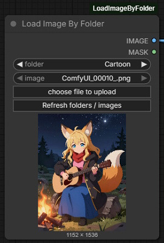

# LoadImageByFolder-ComfyUI

[English](README.md)

一个 ComfyUI 自定义节点，按文件夹组织和选择 input 目录中的图片，避免在一个过长的列表中查找素材。

## 功能

- 分别通过文件夹和图片选择器浏览 ComfyUI 的 input 目录及其子文件夹；`.` 代表 input 根目录。
- 预览所选图片，复用 ComfyUI 原生 LoadImage 实现，输出 `IMAGE` 和 `MASK`。
- 点击 **choose file to upload** 上传图片，或将本地图片拖放到节点，图片会保存到当前选中的 input 文件夹。
- 将 ComfyUI 侧边栏 **Assets** 中的图片拖放到节点，把图片复制到当前选中的 input 文件夹。
- 点击 **Refresh folders / images** 刷新文件夹和图片列表；重新加载工作流时，节点会尝试恢复保存的选择。

支持的文件扩展名：PNG、JPG、JPEG、WEBP、BMP、GIF、TIF 和 TIFF。具体图片格式及动画帧的处理取决于 ComfyUI 原生 LoadImage 的支持情况。

## 安装

1. 打开本项目的 GitHub 页面，通过 **Code** 复制仓库克隆地址。
2. 在终端中进入 `ComfyUI/custom_nodes`，运行 `git clone <仓库地址>`，将 `<仓库地址>` 替换为刚复制的地址。也可以下载仓库 ZIP，并将解压后的项目文件夹放入 `custom_nodes`。
3. 重启 ComfyUI 并刷新浏览器页面。
4. 在 `image` 分类下添加 **Load Image By Folder** 节点。

节点使用 ComfyUI 环境已有的依赖，无需另行安装额外的依赖包。

## 使用方法

1. 在 **folder** 中选择 input 文件夹。例如 `.` 是 input 根目录，`car` 是 `input/car`。
2. 在 **image** 中选择图片，或通过上传按钮、拖放添加图片。如果节点仍显示目标文件夹，新添加的图片会自动选中。
3. 将 `IMAGE` 和／或 `MASK` 输出连接到工作流。

上传或拖放素材期间切换文件夹时，文件仍会保存到操作开始时选中的文件夹。同名文件由 ComfyUI 的上传接口处理。一次拖放多个本地文件时，节点只处理第一个文件。

## 许可证

[MIT 许可证](LICENSE)
